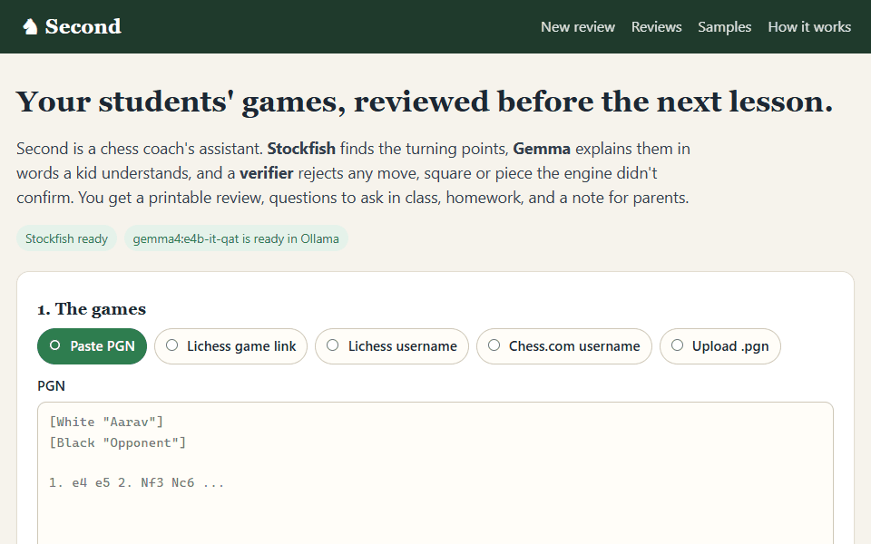
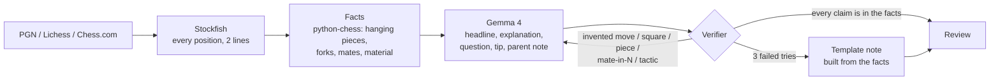

# ♞ Second: a chess coach's AI second

**Stockfish finds it. Gemma explains it. Code checks it.**

**Try it:** https://chess-second.onrender.com (public demo, free instance, so give it a minute to wake up) ·
[sample reviews](https://chess-second.onrender.com/samples)

Second turns your students' games into review sheets you can teach from: the turning points
on board diagrams, a kid-friendly explanation of each one, a question to ask in class, a rule of
thumb, homework, and a WhatsApp-ready note for parents in their own language.

It runs on an ordinary laptop with open models (Stockfish + Gemma 4 through Ollama), so
students' games and names never leave the coach's machine, and a review costs nothing.



In chess, a *second* is the analyst who does the preparation so the player (or the coach) can focus
on the game. That is the job here: the coach still teaches, Second does the Sunday-night homework checking.

## Why the model is never allowed to analyse

Small language models are bad at chess. Ask one to explain a beginner's mistake and it will
confidently mention moves that are illegal, tactics that aren't there and pieces that were never
lost. That is fine for a chatbot and terrible for a ten-year-old who believes every word.

So in Second the language model only writes words. Everything chess-related is decided by code:



1. **Stockfish checks every move.** A move is a mistake when the player's winning chances drop
   by 10+ points (15+ for a blunder), using the same win-chance curve and thresholds as Lichess.
2. **Code turns the analysis into facts.** python-chess works out what actually happened: an
   undefended piece, a fork, a missed or allowed checkmate, a back-rank mate, material won or lost
   along the engine's line.
3. **Gemma writes the notes** from those facts only, for the student's level, plus a summary,
   homework and a note for parents in English, Hindi, Hinglish, Tamil or any other language.
4. **The verifier checks every claim.** Each move, square, "mate in N", move number, evaluation,
   named tactic ("fork", "pin", "sacrifice"...) and "you lose your X" must be in the facts. If not,
   Gemma is told exactly what was wrong and tries again. After three failed tries Second uses a
   plain note built from the facts, so nothing invented reaches a student.

The student's name is never sent to the model either: Gemma writes `[STUDENT]` and Second fills it in.

## Does it work?

I took 16 real games between 1000-1700 rated players from the CC0 Lichess database and had Gemma 4 E4B
explain 29 of their blunders and mistakes three ways: the way people use a chatbot (the moves plus
"explain this mistake"), with Second's engine facts, and through the full Second pipeline.

| | Plain Gemma | Gemma + engine facts | Second |
|---|---|---|---|
| Suggests a concrete move | 14/29 | 29/29 | 29/29 |
| ...and it is Stockfish's better move | **0/29** | 29/29 | 29/29 |
| Mentions a piece move that isn't legal on the board | **7/29** | 0/29 | 0/29 |
| Makes a chess claim the engine didn't confirm | **18/29** | 0/29 | 0/29 |

After a beginner's 14. g4, plain Gemma recommended "14. Nf7", which isn't a legal move in that position.
Given the facts, the same model wrote: *"If you had played Nxh6 instead, you would have won about 2 points
of material."* Method, every note and more examples: [eval/RESULTS.md](eval/RESULTS.md).

## Run it on your laptop

You need Python 3.11+, [Ollama](https://ollama.com/download) and about 7 GB of disk for the model.

**Windows** (downloads Stockfish into `.\bin`, creates `.venv`, pulls the model):

```powershell
git clone https://github.com/dragon-slayer27/chess-second
cd chess-second
powershell -ExecutionPolicy Bypass -File scripts\setup-windows.ps1
.\.venv\Scripts\python.exe -m second serve
```

**macOS / Linux**:

```bash
git clone https://github.com/dragon-slayer27/chess-second && cd chess-second
brew install stockfish            # or: sudo apt install stockfish
ollama pull gemma4:e4b-it-qat
python -m venv .venv && . .venv/bin/activate && pip install -e .
python -m second serve
```

Then open http://127.0.0.1:8000, paste a PGN (or a Lichess / Chess.com username) and pick the student.

On Intel laptops with integrated Arc graphics, set `OLLAMA_IGPU_ENABLE=1` before starting Ollama:
on a Core Ultra 5 125H this made prompt processing 10x faster (31 → 315 tokens/s) and a whole game
review takes about 90 seconds.

### Batch mode

Review a whole PGN file (say, every student's games from the weekend tournament) in one go:

```bash
python -m second review weekend.pgn --student Aarav --level beginner --language Hindi --out reports/
```

Each game produces a self-contained HTML page (print it, or send it to a parent) and an annotated
PGN with the notes as comments and the better moves as variations, ready to import into a
[Lichess study](https://lichess.org/study).

## Configuration

| Variable | Default | |
|---|---|---|
| `SECOND_LLM_BACKEND` | `ollama` | `ollama`, `gemini` (Gemma on Google AI Studio) or `none` (template notes only) |
| `SECOND_OLLAMA_MODEL` | `gemma4:e4b-it-qat` | any Ollama model |
| `SECOND_OLLAMA_URL` | `http://127.0.0.1:11434` | use `https://ollama.com` with `OLLAMA_API_KEY` for Ollama Cloud |
| `GEMINI_API_KEY`, `SECOND_GEMINI_MODEL` | `gemma-4-26b-a4b-it` | for the `gemini` backend |
| `STOCKFISH_PATH` | auto-detected | `PATH`, `./bin`, or the usual install locations |
| `SECOND_ENGINE_DEPTH` | `14` | Stockfish depth per position |
| `SECOND_MAX_MOMENTS` | `4` | key moments per game |
| `SECOND_DATA_DIR` | `./data` | where reviews are stored (git-ignored) |

## The public demo on Render

**Live at https://chess-second.onrender.com.** [`render.yaml`](render.yaml) deploys the same app as a public demo on Render's free plan. A free
instance doesn't have the memory to run Gemma, so the demo runs Stockfish in the container and
asks Gemma 4 on Google AI Studio for the notes. Because the model is open, the prompts, the
verifier and the model family are identical to the laptop version; only the place the weights run
changes. The demo only accepts one public game at a time; students' games belong on the laptop.

## Development

```bash
pip install -e ".[dev]"
pytest          # uses a real Stockfish; the model is replaced by scripted replies
ruff check . && ruff format --check .
```

GitHub Actions runs the tests, then builds the Render Docker image and smoke-tests it.
[`eval/`](eval) has the evaluation: `build_dataset.py` samples games from the Lichess database and
`run_eval.py` produces `RESULTS.md` and `results.json` (every note, every score).

## Credits

- [Stockfish](https://stockfishchess.org) (GPL-3.0), the strongest chess engine in the world, and open source.
- [python-chess](https://github.com/niklasf/python-chess) (GPL-3.0) for move generation, PGN and SVG boards.
- [Gemma 4](https://deepmind.google/models/gemma/gemma-4/) (Apache-2.0) by Google DeepMind, run with [Ollama](https://ollama.com).
- The [Lichess open database](https://database.lichess.org) (CC0) for the evaluation games, and Lichess's published
  win-chance and accuracy formulas, re-implemented in `second/engine.py`.

Second is free software under the GPL-3.0 (see [LICENSE](LICENSE)).

Built in October 2026 for the [DEV Hacktoberfest "Side Hustle" challenge](https://dev.to/challenges/hacktoberfest-week2-2026-10-12),
with GitHub Copilot as a pair programmer.
